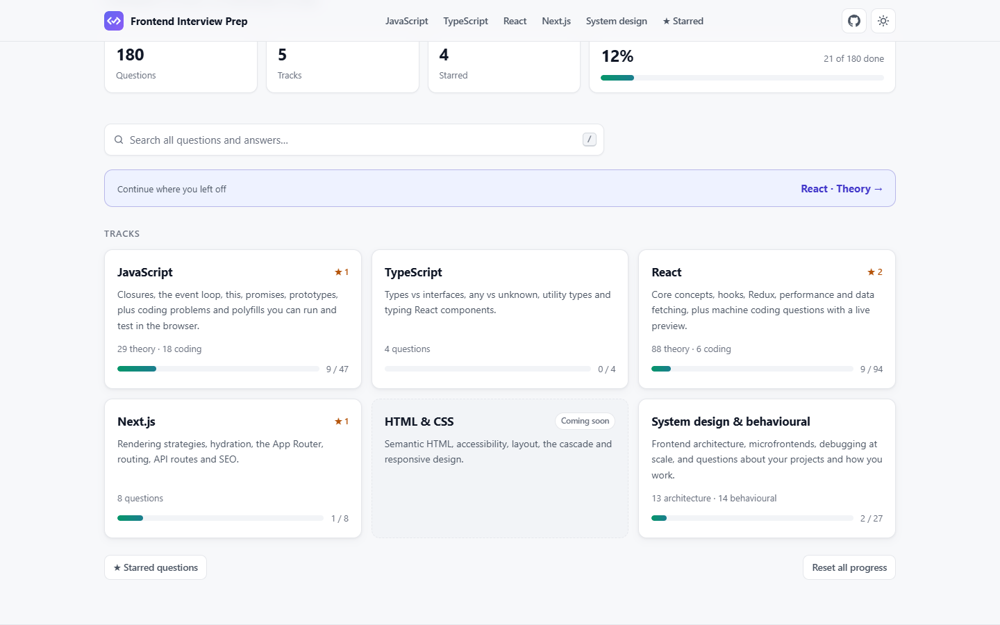
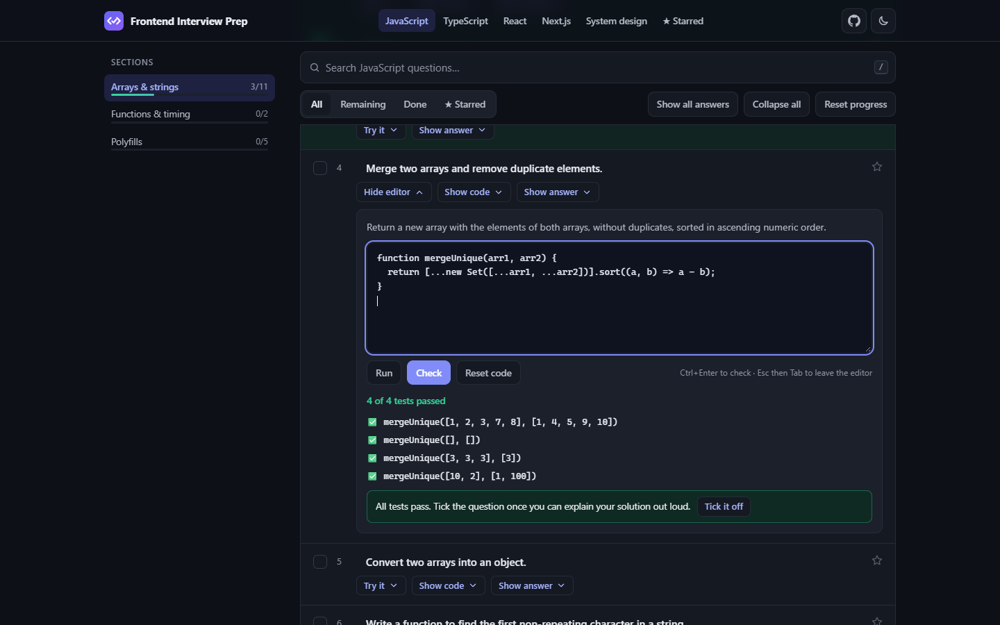

<div align="center">


# Frontend Interview Prep

**180 frontend interview questions with clear answers. Practise, check yourself, track your progress and star questions to review later.**

[**Open the live app →**](https://frontend-interview-prod.vercel.app)

[](https://frontend-interview-prod.vercel.app)


[](LICENSE)

</div>

<p align="center">
  
  
</p>

## About

A focused checklist for mid- to senior-level frontend interviews (around 4–5 years of experience). Each question comes with a concise model answer, and code where it helps.

The recommended way to use it:

1. Read a question and answer it **out loud** first.
2. Open **Show answer** and compare.
3. Tick the question once you can explain it confidently.
4. Not there yet? **Star** it (☆) and come back to it later from the **Starred** page.

## What's covered

Questions are grouped into tracks. Most tracks have a **Theory** tab and a **Coding** tab.

| Track | Tabs | Questions |
|-------|------|:---------:|
| JavaScript | Theory (29) · Coding (18) | 47 |
| TypeScript | Theory | 4 |
| React | Theory (88) · Coding (6) | 94 |
| Next.js | Theory | 8 |
| HTML & CSS | Coming soon | – |
| System design & behavioural | Architecture (13) · Behavioural (14) | 27 |

## Features

- **Tracks** – JavaScript, TypeScript, React, Next.js and system design, each with its own page, tabs and progress. The home page shows every track and links back to where you left off.
- **Progress tracking** – ticks are saved in your browser (`localStorage`); no account needed.
- **Star for review** – star any question to build your own review list, collected on the **Starred** page. Stars are saved too, and **Reset progress** keeps them.
- **Search** questions *and* answers, across all tracks from the home page or within a track. Press <kbd>/</kbd> to jump to search, <kbd>Esc</kbd> to clear.
- **Filters** – All, Remaining, Done and Starred.
- **Section sidebar** with per-section progress and the current section highlighted.
- **Light and dark themes**, following your system setting by default.
- **Code editor** for the coding questions. JavaScript questions have **Run** (shows `console.log` output) and **Check** (runs test cases and shows expected vs. received). React questions render a live preview. Drafts are saved in your browser.
- **Copy buttons** on code examples.
- **Accessible** – keyboard friendly, proper ARIA states, respects reduced-motion.
- **Fast and private** – plain HTML, CSS and JavaScript. No build step, no tracking, no third-party requests (except the public test APIs that your own React code calls in the preview).

## Run locally

No install needed. Clone the repo and either open `index.html` directly or serve the folder:

```bash
git clone https://github.com/chaudharyShub/frontend-interview-prep.git
cd frontend-interview-prep
npx serve .
```

`npx serve` reads `serve.json`, so track pages like `/react` work. Other servers (e.g. `python -m http.server`) don't know those addresses; use `/?track=react` there, or open the file directly.

The code editor works either way. Opened as a file, it runs with slightly looser isolation (no network block in the JS runner, no sandbox on the React preview), which is fine for running your own code locally.

## Project structure

```
.
├── index.html              # Page markup and meta tags
├── assets/
│   ├── css/styles.css      # All styles (light + dark themes)
│   ├── js/tracks/          # Question bank, one file per track – edit these to add questions
│   ├── js/app.js           # Routing, home page, rendering, search, filters, progress
│   ├── js/theme.js         # Applies the saved theme before first paint
│   ├── js/challenges.js    # Starter code and test cases for the code editor
│   ├── js/editor.js        # Code editor UI (Try it / Run / Check)
│   ├── js/runner.js        # Web Worker that runs JS code and tests (2 s timeout)
│   ├── js/preview.js       # React preview: compiles JSX and renders it
│   ├── js/loop-guard.js    # Adds infinite-loop checks to React preview code
│   ├── css/preview.css     # Styles inside the React preview
│   ├── vendor/             # React, ReactDOM and Sucrase (copied in, loaded only by the preview)
│   ├── favicon.svg
│   └── og-image.png        # Link preview image
├── react-preview.html      # Page loaded in a sandboxed iframe for React previews
├── docs/                   # README screenshots
├── serve.json              # Track page addresses for `npx serve`
└── vercel.json             # Track page addresses, security headers and caching
```

## Adding or editing questions

Questions live in [`assets/js/tracks/`](assets/js/tracks/), one file per track. A track has tabs, a tab has sections, and a section has `items`:

```js
{
  "id": "177",          // unique and stable – progress, stars and drafts are saved against it
  "q": "What is ...?",  // the question
  "a": "Answer text…"   // supports paragraphs, - lists, 1. lists, `code`, **bold** and ``` fences
}
```

Optional fields:

| Field | Purpose |
|-------|---------|
| `note` | Short hint shown under the question |
| `code` | Code snippet shown with a **Show code** button |

Question numbers are worked out from the order in each tab. Never change the `id` of an existing question, or people will lose their progress and stars for it. Moving a question to another track or tab is fine.

To add a track, create a file in `assets/js/tracks/`, add a `<script>` tag for it in `index.html`, and add its slug to the rewrites in `vercel.json` and `serve.json`.

## Adding a coding challenge

Coding challenges live in [`assets/js/challenges.js`](assets/js/challenges.js), keyed by question `id`. A question with an entry there gets a **Try it** button.

```js
'95': {
  fn: 'charFrequency',                       // function the user writes
  task: 'Return an object mapping …',        // exact spec, including edge cases
  starter: 'function charFrequency(str) {\n  \n}\n',
  tests: [
    { args: ['aabcabcb'], expected: { a: 3, b: 3, c: 2 } },
    { args: [''], expected: {} },
  ],
}
```

Results are compared deeply, so object key order doesn't matter. For polyfills and timing questions, a test can use `run: (fn, t) => actual` instead of `args`; see the debounce and `myMap` entries for examples. React challenges only need `react: true`, a `task` and `starter` code.

### How code runs safely

- **JavaScript** runs in a fresh Web Worker for every run, stopped after 2 seconds, with no network access. Only `runner.js` is allowed to use `new Function` (see `vercel.json`); the main page keeps a strict security policy.
- **React** code runs in `react-preview.html` inside a sandboxed iframe, so it can't read the page or your saved progress. JSX is compiled by [Sucrase](https://github.com/alangpierce/sucrase).
- **Infinite loops in React code:** after compiling, every `while`, `do…while` and `for(;;)` loop gets a time check (`loop-guard.js`). A loop that runs for over 1 second in one go (a render, a click handler, an effect) throws an error that is shown in the preview. If the preview still stops responding, the editor shuts the frame down after 3 seconds.

## Contributing

Spotted a mistake or have a question worth adding? [Open an issue](https://github.com/chaudharyShub/frontend-interview-prep/issues/new) or send a pull request.

## Deployment

The site is deployed on [Vercel](https://vercel.com). Every push to `main` goes live automatically; no build settings are needed.

## More from the author

- [Portfolio](https://shubhamworks.vercel.app/)
- [AWS Cloud Practitioner practice exams](https://cloud-prep-aws.vercel.app/)

## License

[MIT](LICENSE) © Shubham Chaudhary
